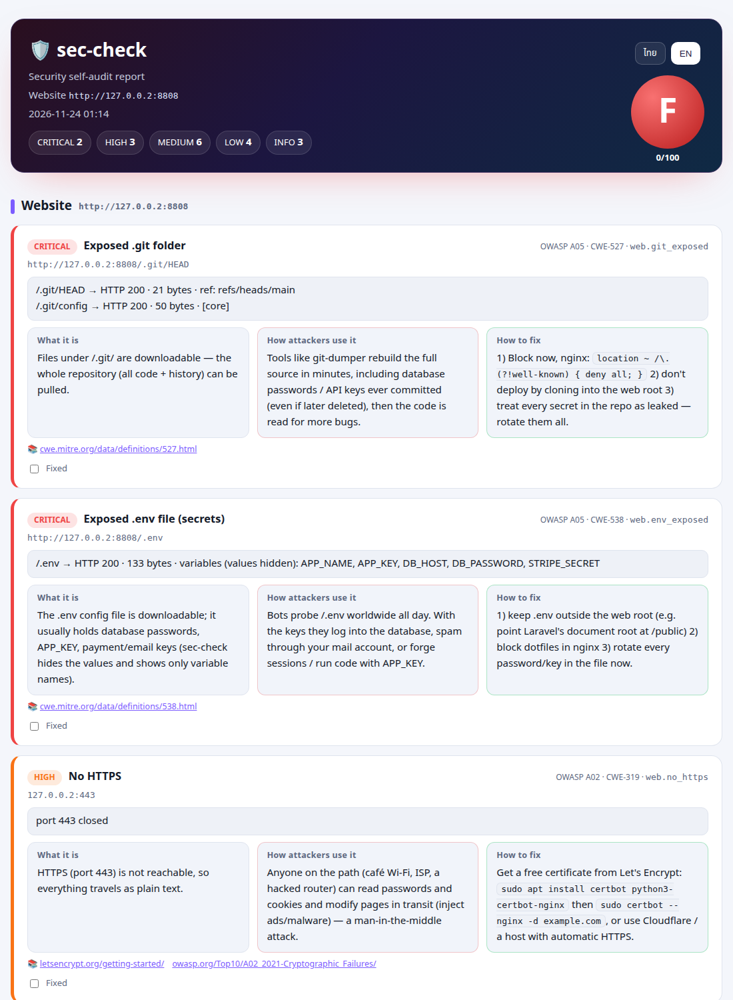
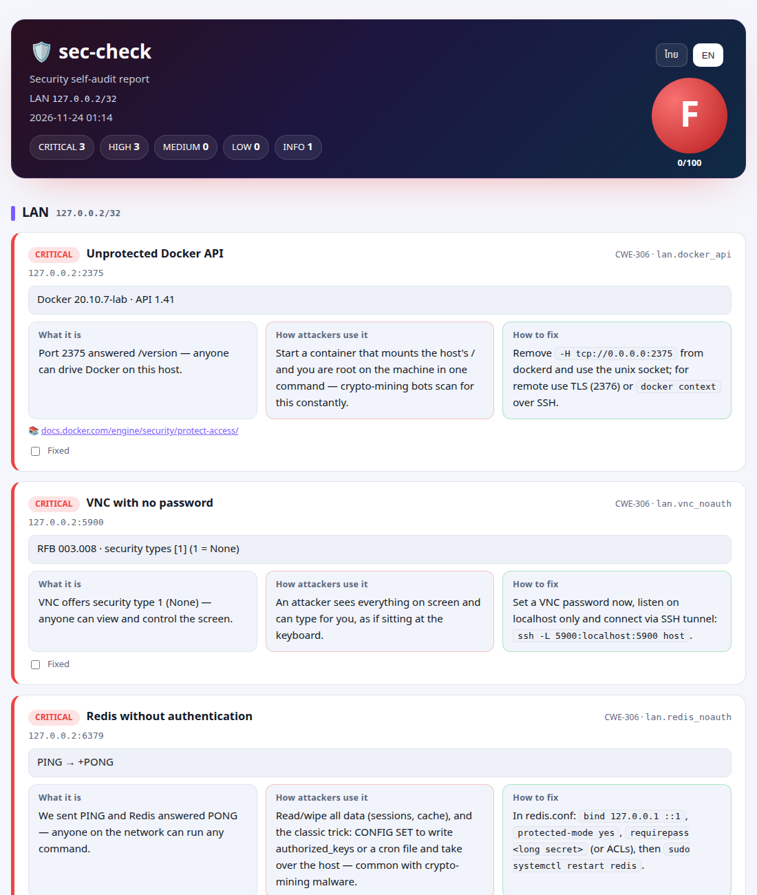
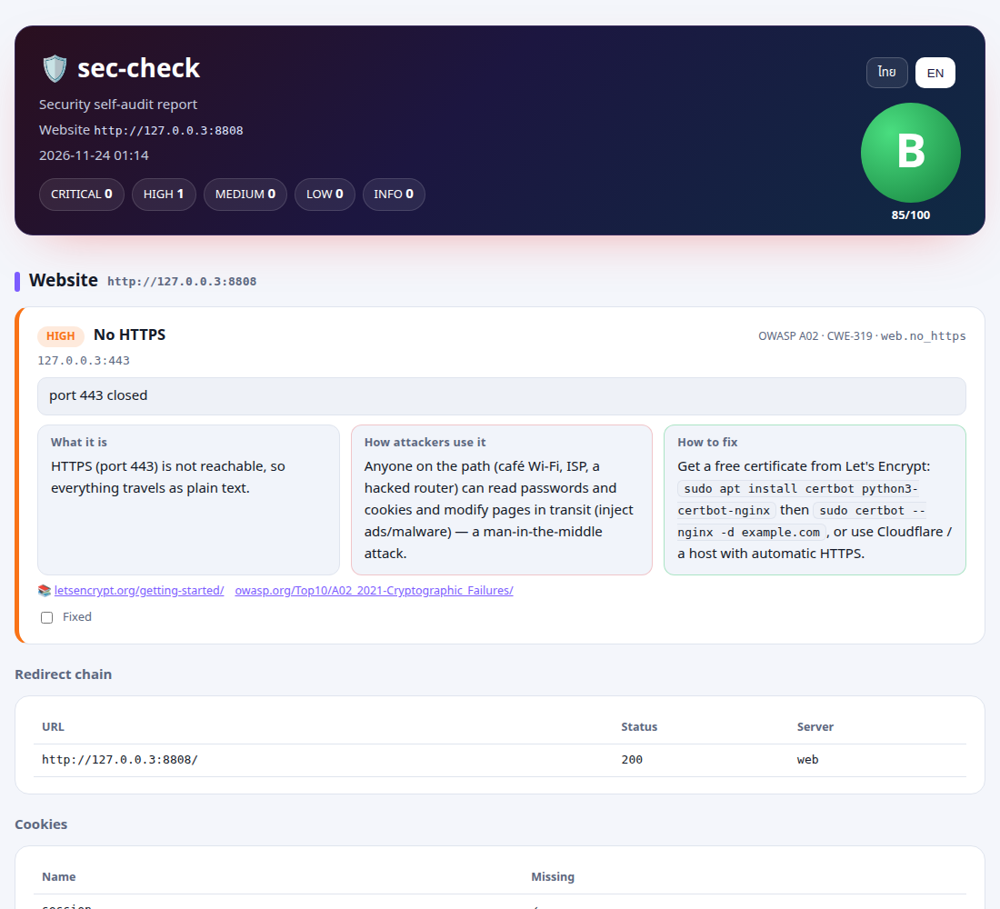

<div align="center">

# 🛡️ sec-check

**Find weaknesses in systems you own — and learn how each attack works and how to fix it.**
A non-destructive self-audit for your website, home/office LAN, Linux machine and router/Wi-Fi, with a bilingual HTML report that explains every finding.

[](#requirements)
[](#requirements)
[](#requirements)
[](#languages)
[](LICENSE)

**English** · [ภาษาไทย](README.th.md)

 

</div>

> ⚖️ **Only test systems you own or have written permission to test.** Scanning other people's systems
> without permission is illegal in most countries (in Thailand: Computer Crime Act B.E. 2550, sections 5–7).
> sec-check enforces this with an allow-list — see [Safety model](#-safety-model).

---

## ✨ What it does

Every finding in the report comes with three boxes: **What it is**, **How attackers use it**, and **How to fix it** (with the exact config line or command), plus OWASP/CWE tags and references. Each one has a "Fixed" checkbox so you can work through the list. There are **87 lessons** — list them with `./seccheck.py lessons`.

| Module | Checks | Examples |
|---|---|---|
| 🌐 **web** | 30 | HTTPS & certificate, TLS 1.0/1.1, HTTP→HTTPS, HSTS, CSP, clickjacking, cookies (HttpOnly/Secure/SameSite), CORS origin reflection, version leaks, exposed `.git` / `.env` / SQL dumps / backups, `phpinfo()`, directory listing, debug error pages, robots.txt hints, security.txt |
| 🖧 **lan** | 22 | Host discovery without root, ~40 common ports per host, plus read-only probes: Redis with no auth, VNC with no password, open Docker API, Elasticsearch, memcached, Telnet, FTP, SMB, RDP, databases, MQTT, IP cameras (RTSP), printers, NFS, TR-069 |
| 🐧 **host** | 20 | Services listening on the network, ufw firewall, sshd config (root login, passwords), pending security updates, unattended-upgrades, reboot needed, `/etc/shadow` permissions, `~/.ssh` permissions & keys without a passphrase, ASLR, disk encryption, auto-login, screen lock, Samba guest shares |
| 📶 **router** | 9 + 6 checklist | Open ports on the router, admin page over HTTP, UPnP, Wi-Fi encryption (open/WEP/WPA1/WPA2/WPA3), DNS in use, plus a hand-check list: admin password, WPS, firmware, remote management, guest/IoT network, port forwards |

**Safe by design:** it only connects, reads banners and sends normal `GET`/`HEAD`/`OPTIONS` requests. It **never** sends attack payloads (no SQLi/XSS strings), never guesses or tries passwords (not even router defaults), never logs in, never submits forms, and never writes or deletes anything on a target. Secrets it stumbles on are redacted: for an exposed `.env` the report shows variable names only.

## 🚀 Quick start

```bash
git clone https://github.com/6amdev/sec-check.git
cd sec-check

./seccheck.py host                     # audit this Linux machine (always allowed, no sudo)

python3 lab/vulnlab.py &               # start the practice lab (loopback only)
./seccheck.py web http://127.0.0.2:8808 --open   # weak site → grade F
./seccheck.py web http://127.0.0.3:8808 --open   # same site, hardened → compare!
./seccheck.py lan 127.0.0.2            # fake Redis/VNC/Docker/Telnet …
```

To check your real systems, add them to the allow-list first (you must type `yes` to confirm ownership):

```bash
./seccheck.py scope add https://example.com --note "my shop"
./seccheck.py scope add 192.168.1.0/24 --note "home LAN"
./seccheck.py scope add 192.168.1.1 --note "router"
./seccheck.py scope list

./seccheck.py web https://example.com
./seccheck.py lan                      # defaults to this machine's network
./seccheck.py router                   # defaults to the default gateway
./seccheck.py all                      # host + router + LAN + every web target in scope → one report
```

Reports are saved to `reports/` as HTML (switchable Thai/English, light/dark) and JSON. The folder is git-ignored. The HTML describes your systems, so don't publish it.

### Learn

```bash
./seccheck.py lessons                       # every check, with its severity
./seccheck.py explain web.cors_reflect      # read one lesson in the terminal
./seccheck.py --lang en explain lan.redis_noauth
```

## 🧪 Practice lab

`lab/vulnlab.py` starts deliberately vulnerable **fake** services, bound to loopback only (`127.0.0.2` / `127.0.0.3`) so nothing on your network can reach them:

| Address | What |
|---|---|
| `http://127.0.0.2:8808` | Weak web shop: exposed `.git`, `.env` (fake values), `backup.sql`, `phpinfo`, directory listing, stack traces, reflected CORS with credentials, cookie without flags, version headers, TRACE/PUT |
| `http://127.0.0.3:8808` | The same shop with every fix applied — diff the two reports |
| `127.0.0.2` : 2323 / 6379 / 5900 / 11211 / 2375 / 9200 | Fake Telnet, Redis (no auth), VNC (no auth), memcached, Docker API, Elasticsearch |

**Suggested path:** scan the weak site → read each lesson → open `lab/vulnlab.py`, find the `Weak` handler line that causes it → compare with the `Safe` handler → apply the same fix to your real server → re-scan.



## 🔒 Safety model

- **Allow-list (`scope.json`, git-ignored).** Every web/LAN/router check calls `scope.check()` first. Targets are added only through `scope add`, which asks you to type `yes`. Loopback (`127.0.0.0/8`, `::1`, `localhost`) is always allowed. The host module audits only the local machine.
- **Matching is strict:** `*.example.com` covers subdomains; a CIDR covers only addresses inside it; a bigger network than you added is refused. Redirects to hosts outside the scope are not followed. See `tests/test_scope.py`.
- **Gentle:** web checks send about 40 requests with a 0.15 s delay (`--delay`). LAN scans are capped at 1024 addresses (`--max-hosts`).
- **No root needed.** Anything that needs root is printed as a command for you to run yourself (e.g. `sudo ufw status verbose`, `sudo lynis audit system`).

## 🗂️ Project layout

```
seccheck.py          CLI
core/                scope (allow-list), net (safe helpers), finding, kb (knowledge loader), report (HTML/JSON)
checks/              web.py · lan.py · host.py · router.py   — each has run(target, opts) -> Result
knowledge/*.json     the lessons: severity, tag, title/what/attack/fix in th+en, refs
lab/vulnlab.py       practice lab (loopback only)
locales/en.json      UI translations (Thai is the source language, like disk-check)
tests/               python3 -m unittest discover -s tests
```

**Adding a check:** add a lesson to `knowledge/<module>.json`, then in `checks/<module>.py` call `res.add("<id>", target, evidence)` when it's a problem or `res.ok("<Thai label>", target)` when it passes. Add a vulnerable and a fixed version to the lab so you can see both.

## 🧭 Roadmap

- [ ] `diff` two reports: what got fixed, what's new
- [ ] Scheduled scans + a phone dashboard on the LAN (like disk-check's web app)
- [ ] Optional wrappers when installed: `nmap -sV`, `nuclei`, `testssl.sh`, `lynis`, merged into the same report
- [ ] DNS/e-mail checks for your domain: SPF, DKIM, DMARC, DNSSEC, CAA, dangling subdomains
- [ ] Lab-only "attack demos" (SQL injection, XSS, CSRF) against the practice lab, to see the attack and then the fix

## Requirements

Python 3.8+ on Linux (made on Ubuntu 24.04). Standard library only. It uses `ss`, `ip`, `apt`, `lsblk`, `nmcli`, `gsettings` and `resolvectl` when they are present.

## Languages

Thai is the default. Use `--lang en` or `SECCHECK_LANG=en` for English output. The HTML report contains both languages, with a toggle at the top.

## License

[MIT](LICENSE) — for learning and defending your own systems.
