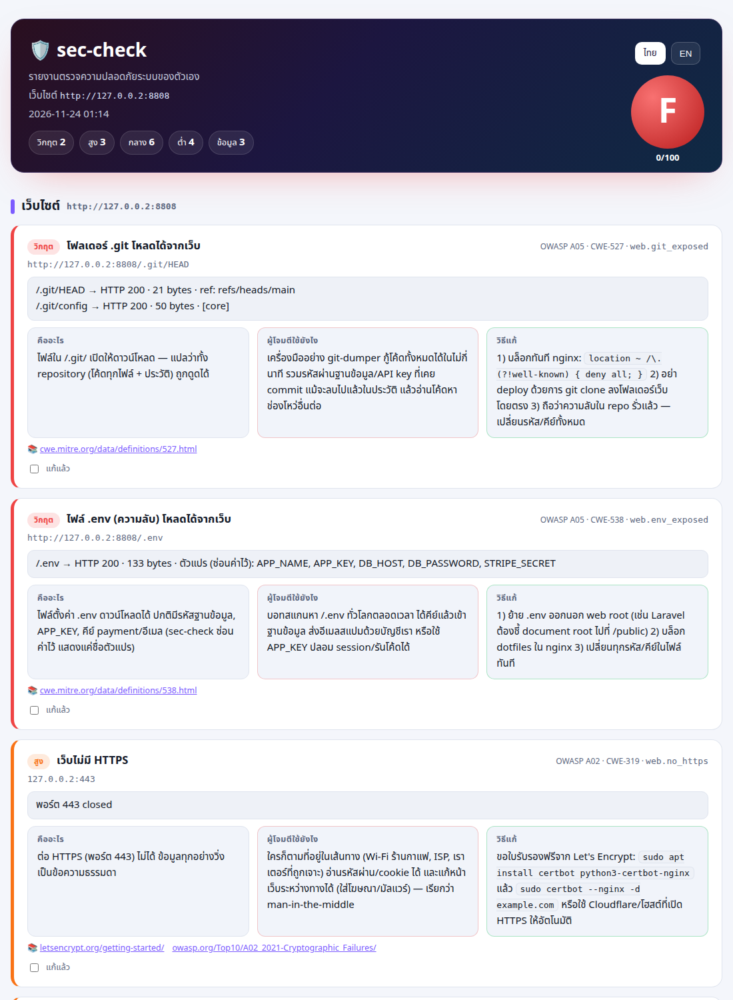
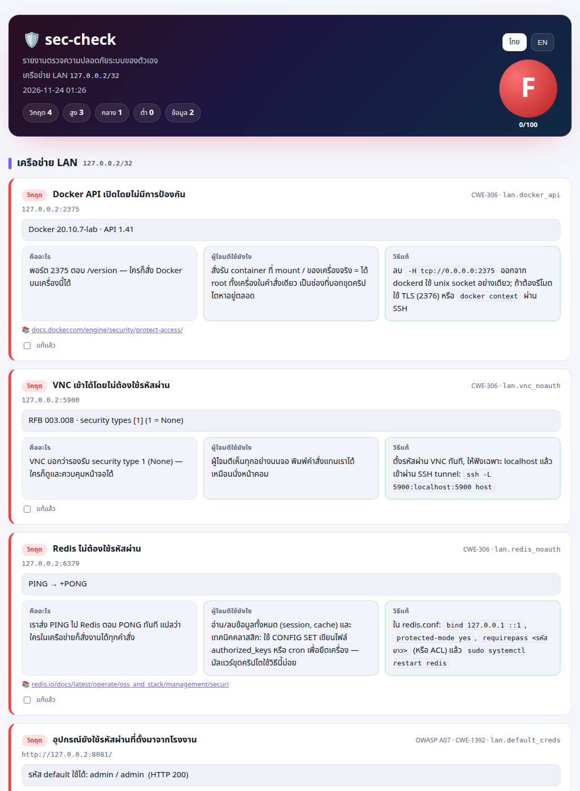
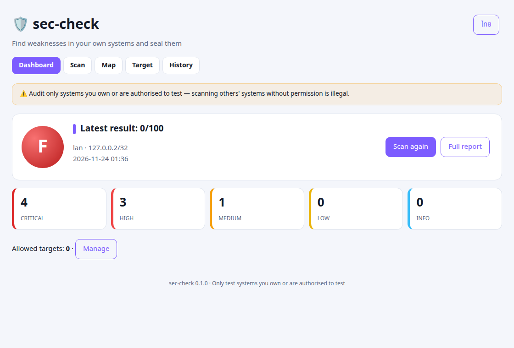
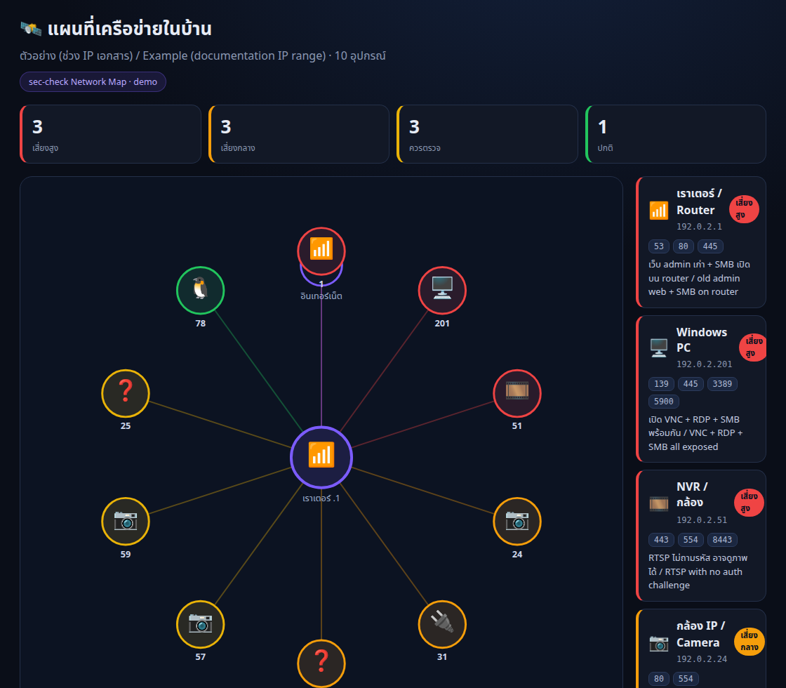
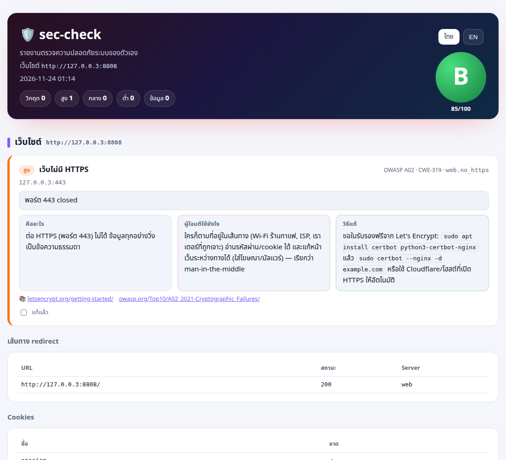

<div align="center">

# 🛡️ sec-check

**ตรวจหาจุดอ่อนในระบบของตัวเอง แล้วเรียนรู้ว่าผู้โจมตีใช้ช่องนั้นยังไง และต้องแก้ยังไง**
ตรวจแบบไม่ทำลายครอบคลุมเว็บไซต์ วงแลนบ้าน/ออฟฟิศ เครื่อง Linux และเราเตอร์/Wi-Fi พร้อมรายงาน HTML สองภาษาที่อธิบายทุกข้อที่เจอ

[](#สิ่งที่ต้องมี)
[](#สิ่งที่ต้องมี)
[](#สิ่งที่ต้องมี)
[](#ภาษา)
[](LICENSE)

[English](README.md) · **ภาษาไทย**

 

</div>

> ⚖️ **ใช้ตรวจได้เฉพาะระบบที่คุณเป็นเจ้าของ หรือได้รับอนุญาตเป็นลายลักษณ์อักษรเท่านั้น**
> การสแกนระบบของผู้อื่นโดยไม่ได้รับอนุญาตผิดกฎหมาย (พ.ร.บ.คอมพิวเตอร์ฯ พ.ศ. 2550 มาตรา 5–7)
> sec-check บังคับเรื่องนี้ด้วยรายชื่อเป้าหมายที่อนุญาต (allow-list) — ดู [ระบบความปลอดภัยของตัวเครื่องมือ](#-ระบบความปลอดภัยของตัวเครื่องมือ)

---

## ✨ ทำอะไรได้

ทุกข้อที่เจอในรายงานมี 3 กล่อง: **คืออะไร**, **ผู้โจมตีใช้ยังไง**, **วิธีแก้** (บอกบรรทัด config หรือคำสั่งที่ใช้จริง) พร้อมแท็ก OWASP/CWE และลิงก์อ่านต่อ แต่ละข้อมีช่องติ๊ก "แก้แล้ว" ไว้ไล่แก้ทีละข้อ มีบทเรียนทั้งหมด **98 บท** ดูรายการได้ด้วย `./seccheck.py lessons`

| โมดูล | จำนวนข้อ | ตัวอย่าง |
|---|---|---|
| 🌐 **web** | 30 | HTTPS และใบรับรอง, TLS 1.0/1.1, HTTP→HTTPS, HSTS, CSP, clickjacking, cookie (HttpOnly/Secure/SameSite), CORS ที่สะท้อน Origin, การเผยเวอร์ชัน, ไฟล์หลุด `.git` / `.env` / ไฟล์ SQL / backup, `phpinfo()`, directory listing, หน้า error ที่เผยรายละเอียด, robots.txt, security.txt |
| 🖧 **lan** | 26 | หาเครื่องในวงโดยไม่ต้องใช้ root, เดาชนิดอุปกรณ์, ตรวจ ~40 พอร์ตต่อเครื่อง, "ทักทาย" แบบอ่านอย่างเดียว: Redis/VNC ไม่มีรหัส, Docker API เปิดโล่ง, Elasticsearch, memcached, Telnet, FTP, SMB, RDP, ฐานข้อมูล, MQTT, **กล้องที่สตรีม RTSP ได้โดยไม่ต้องล็อกอิน**, **หน้าล็อกอิน Basic auth บน HTTP**, **ลองรหัส default (เปิดด้วย --default-creds)**, เครื่องพิมพ์, NFS, TR-069 |
| 🐧 **host** | 27 | บริการที่เปิดรับจากเครือข่าย, firewall (ufw), ตั้งค่า sshd (root/รหัสผ่าน), **บัญชี UID 0 และ sudo, รหัสผ่านว่าง, การ hash รหัสผ่าน + pwquality, ไฟล์ที่ใครก็เขียนได้, ไฟล์ SUID**, อัปเดตที่ค้าง, อัปเดตอัตโนมัติ, ต้องรีบูต, สิทธิ์ `/etc/shadow` และ `~/.ssh`, กุญแจที่ไม่มี passphrase, ASLR, เข้ารหัสดิสก์, ล็อกอินอัตโนมัติ, ล็อกหน้าจอ, แชร์ Samba แบบ guest |
| 📶 **router** | 9 + checklist 6 | พอร์ตที่เปิดบนเราเตอร์, หน้า admin ใช้ HTTP, UPnP, การเข้ารหัส Wi-Fi (เปิดโล่ง/WEP/WPA1/WPA2/WPA3), DNS ที่ใช้อยู่ + รายการที่ต้องตรวจเองในหน้า admin: รหัส admin, WPS, เฟิร์มแวร์, การจัดการจากระยะไกล, Wi-Fi แขก/IoT, port forward |

**ปลอดภัยตั้งแต่การออกแบบ:** ทำแค่เชื่อมต่อ อ่านแบนเนอร์ และส่ง `GET`/`HEAD`/`OPTIONS` แบบปกติ **ไม่ส่ง** payload โจมตี (ไม่มีข้อความ SQLi/XSS), ไม่ส่งฟอร์ม และไม่เขียนหรือลบอะไรบนเป้าหมาย ถ้าบังเอิญเจอความลับ จะซ่อนค่าไว้ เช่น ไฟล์ `.env` ที่หลุด รายงานจะแสดงแค่ชื่อตัวแปร

ข้อยกเว้นเดียว (ปิดไว้เป็นค่าเริ่มต้น) คือ `--default-creds`: เมื่อเปิด โมดูล lan จะลองรหัสที่ตั้งมาจากโรงงานชุดเล็กๆ (admin/admin …) **เฉพาะเป้าหมายใน allow-list** ผ่าน HTTP **Basic auth** (เป็น `GET` อ่านอย่างเดียว ไม่เปลี่ยนค่าอะไร) ทีละชุด จำกัดอัตรา และหยุดทันทีที่เจอรหัสที่ใช้ได้ ไม่ยุ่งกับฟอร์มล็อกอิน (การ POST อาจล็อกบัญชี) ไว้สำหรับตรวจเราเตอร์/กล้อง/NAS **ของตัวเอง**

## 🚀 เริ่มใช้งาน

```bash
git clone https://github.com/6amdev/sec-check.git
cd sec-check

./seccheck.py host                     # ตรวจเครื่อง Linux นี้ (อนุญาตเสมอ ไม่ต้อง sudo)

python3 lab/vulnlab.py &               # เปิดสนามฝึก (ฟังเฉพาะเครื่องนี้)
./seccheck.py web http://127.0.0.2:8808 --open   # เว็บที่มีช่องโหว่ → เกรด F
./seccheck.py web http://127.0.0.3:8808 --open   # เว็บเดียวกันที่แก้แล้ว → เอามาเทียบกัน!
./seccheck.py lan 127.0.0.2            # Redis/VNC/Docker/Telnet ปลอม …
```

ถ้าจะตรวจระบบจริง ต้องเพิ่มเป้าหมายเข้ารายชื่อที่อนุญาตก่อน (ต้องพิมพ์ `yes` ยืนยันว่าเป็นเจ้าของ):

```bash
./seccheck.py scope add https://example.com --note "ร้านของฉัน"
./seccheck.py scope add 192.168.1.0/24 --note "วงแลนบ้าน"
./seccheck.py scope add 192.168.1.1 --note "เราเตอร์"
./seccheck.py scope list

./seccheck.py web https://example.com
./seccheck.py lan                      # ค่าเริ่มต้นคือวงแลนของเครื่องนี้
./seccheck.py router                   # ค่าเริ่มต้นคือ gateway ของเครื่องนี้
./seccheck.py all                      # host + router + LAN + ทุกเว็บใน scope → รวมเป็นรายงานเดียว
```

รายงานจะอยู่ใน `reports/` เป็น HTML (สลับไทย/อังกฤษได้ รองรับโหมดสว่าง/มืด) และ JSON โฟลเดอร์นี้ไม่ถูกเก็บใน git และเพราะรายงานบอกรายละเอียดระบบของคุณ อย่าเผยแพร่สาธารณะ

### หน้าเว็บ (Web UI)

ถ้าชอบใช้เบราว์เซอร์ sec-check มีหน้าเว็บที่เสิร์ฟจาก Python เอง (ไม่มี build step เหมือน disk-check): Dashboard, หน้า Scan (เลือกเป้าจาก allow-list เห็นผล 🔴/🟢), **แผนที่เครือข่าย** ของวงแลน, ประวัติการสแกน และรายงานเต็ม:

```bash
./web.sh                       # http://127.0.0.1:8770 (เฉพาะเครื่องนี้)
./web.sh --host 0.0.0.0 --pin 1234   # เปิดดูจากมือถือในวงแลน (ตั้ง PIN)
```

หน้าเว็บใช้ engine ตัวเดียวกันและ allow-list เดียวกัน: สแกนได้เฉพาะเป้าใน `scope.json`, แบบไม่ทำลาย, และมีคำเตือนทางกฎหมายทุกหน้า ผลเก็บใน SQLite (`data/` ไม่ขึ้น git) หน้า **ประวัติ** จึงเทียบสองการสแกนได้ว่า **แก้แล้ว (🔴→🟢)** ข้อไหน, **โผล่ใหม่** ข้อไหน, **ยังเจาะได้อยู่** ข้อไหน หลังจากคุณอุดช่องโหว่

ทุกเช็กมี **ระดับความยาก (1–5)** — ระดับ 1 คือของเปิดโล่งเจอง่าย (รหัส default, ไม่มี auth, ไฟล์หลุด) ไล่ขึ้นไปจนถึงการตั้งค่าพลาดเชิงลึกที่ระดับ 4 เลือกระดับได้ในหน้า Scan หรือด้วย `--level` ใน CLI (`./seccheck.py host --level 1`) เพื่อโฟกัสของง่ายก่อน

 

*(แผนที่ด้านบนเป็นอุปกรณ์ตัวอย่างในช่วง IP สำหรับเอกสาร — หน้าจริงสร้างจากการสแกนของคุณเอง)*

นี่คือ **เฟส 1** ตาม[ดีไซน์](docs/DESIGN.md) · REST API และ MCP server (ให้เครื่องมือ AI สั่งสแกนได้) อยู่ในเฟสถัดไป

### เรียนรู้

```bash
./seccheck.py lessons                       # ทุกข้อที่ตรวจได้ พร้อมระดับความรุนแรง
./seccheck.py explain web.cors_reflect      # อ่านบทเรียนทีละข้อใน Terminal
./seccheck.py --lang en explain lan.redis_noauth
```

## 🧪 สนามฝึก

`lab/vulnlab.py` เปิดบริการ**ปลอม**ที่ตั้งใจให้มีช่องโหว่ โดยฟังเฉพาะ loopback (`127.0.0.2` / `127.0.0.3`) เครื่องอื่นในเครือข่ายจึงเข้าไม่ได้:

| ที่อยู่ | คืออะไร |
|---|---|
| `http://127.0.0.2:8808` | ร้านค้าที่มีช่องโหว่: `.git` หลุด, `.env` (ค่าปลอม), `backup.sql`, `phpinfo`, directory listing, stack trace, CORS สะท้อน Origin พร้อม credentials, cookie ไม่ตั้งค่า, header บอกเวอร์ชัน, TRACE/PUT |
| `http://127.0.0.3:8808` | ร้านเดียวกันที่แก้ครบทุกข้อแล้ว — เทียบรายงานสองอันนี้ดู |
| `127.0.0.2` : 2323 / 6379 / 5900 / 11211 / 2375 / 9200 / 8081 / 8554 | Telnet, Redis (ไม่มีรหัส), VNC (ไม่มีรหัส), memcached, Docker API, Elasticsearch ปลอม + หน้า admin เราเตอร์ที่ใช้รหัส default `admin/admin` (Basic auth) และกล้อง RTSP ที่ไม่ต้องล็อกอิน |

**แนะนำให้ฝึกตามลำดับนี้:** สแกนเว็บที่มีช่องโหว่ → อ่านบทเรียนแต่ละข้อ → เปิด `lab/vulnlab.py` หาบรรทัดใน `Weak` ที่ทำให้เกิดปัญหานั้น → เทียบกับ `Safe` → เอาวิธีแก้เดียวกันไปใช้กับเซิร์ฟเวอร์จริง → สแกนซ้ำ



## 🔒 ระบบความปลอดภัยของตัวเครื่องมือ

- **รายชื่อที่อนุญาต (`scope.json` ไม่ถูกเก็บใน git):** การตรวจ web/LAN/router ทุกครั้งจะเรียก `scope.check()` ก่อน เป้าหมายจะเข้ารายชื่อได้ทางเดียวคือ `scope add` ซึ่งต้องพิมพ์ `yes` ยืนยัน เครื่องตัวเอง (`127.0.0.0/8`, `::1`, `localhost`) อนุญาตเสมอ ส่วนโมดูล host ตรวจแค่เครื่องที่รันอยู่
- **จับคู่แบบเข้มงวด:** `*.example.com` ครอบคลุม subdomain, CIDR ครอบคลุมเฉพาะที่อยู่ในวงนั้น, ถ้าขอวงใหญ่กว่าที่เพิ่มไว้จะถูกปฏิเสธ และไม่ตาม redirect ไปยัง host นอกรายชื่อ (ดู `tests/test_scope.py`)
- **สแกน LAN ได้เฉพาะวงส่วนตัว:** โมดูล lan ปฏิเสธเป้าหมายที่ไม่ใช่วง RFC1918 (10/8, 172.16/12, 192.168/16) หรือ loopback เป็นเกราะชั้นที่สองนอกเหนือจาก allow-list
- **ลองรหัส default เป็นแบบเปิดเอง อ่านอย่างเดียว และชุดเล็ก:** `--default-creds` ลองรหัสยอดนิยม ~10 ชุดผ่าน Basic auth (เป็น `GET`), จำกัดอัตรา, เจอชุดแรกที่ใช้ได้ก็หยุด, เฉพาะใน allow-list ไม่มี brute force ไม่ยุ่งฟอร์ม ไม่มีอะไรที่ทำให้บัญชีถูกล็อกหรืออุปกรณ์ล่ม
- **เบามือ:** ตรวจเว็บประมาณ 40 request โดยเว้นช่วง 0.15 วินาที (`--delay`) และสแกน LAN ได้ไม่เกิน 1024 address (`--max-hosts`)
- **ไม่ต้องใช้ root:** อะไรที่ต้องใช้ root จะพิมพ์คำสั่งให้ไปรันเองใน Terminal (เช่น `sudo ufw status verbose`, `sudo lynis audit system`)

## 🗂️ โครงสร้าง

```
seccheck.py          CLI
core/                scope (รายชื่อที่อนุญาต), net (ตัวช่วยที่ปลอดภัย), finding, kb (โหลดบทเรียน), report (HTML/JSON)
checks/              web.py · lan.py · host.py · router.py   — แต่ละไฟล์มี run(target, opts) -> Result
knowledge/*.json     บทเรียน: ระดับความรุนแรง, แท็ก, หัวข้อ/คืออะไร/โจมตียังไง/แก้ยังไง (ไทย+อังกฤษ), ลิงก์
lab/vulnlab.py       สนามฝึก (เฉพาะเครื่องนี้)
locales/en.json      คำแปล UI (ใช้ภาษาไทยเป็นต้นฉบับ แบบเดียวกับ disk-check)
tests/               python3 -m unittest discover -s tests
```

**เพิ่มการตรวจใหม่:** เขียนบทเรียนใน `knowledge/<module>.json` แล้วใน `checks/<module>.py` เรียก `res.add("<id>", เป้าหมาย, หลักฐาน)` เมื่อเจอปัญหา หรือ `res.ok("<ข้อความไทย>", เป้าหมาย)` เมื่อผ่าน และใส่ทั้งแบบมีช่องโหว่และแบบแก้แล้วไว้ในสนามฝึก จะได้เห็นทั้งสองแบบ

## 🧭 แผนต่อไป

- [ ] `diff` เทียบรายงานสองครั้ง: ข้อไหนแก้แล้ว ข้อไหนเพิ่งเจอ
- [ ] ตั้งเวลาสแกน + หน้าดูผลบนมือถือในวงแลน (แบบเว็บแอปของ disk-check)
- [ ] ใช้เครื่องมือภายนอกเสริมถ้าติดตั้งไว้: `nmap -sV`, `nuclei`, `testssl.sh`, `lynis` แล้วรวมผลในรายงานเดียวกัน
- [ ] ตรวจ DNS/อีเมลของโดเมน: SPF, DKIM, DMARC, DNSSEC, CAA, subdomain ที่ชี้ไปที่ว่าง
- [ ] "สาธิตการโจมตี" เฉพาะในสนามฝึก (SQL injection, XSS, CSRF) ให้เห็นการโจมตีแล้วตามด้วยวิธีแก้

## สิ่งที่ต้องมี

Python 3.8 ขึ้นไปบน Linux (พัฒนาบน Ubuntu 24.04) ใช้แค่ standard library ถ้ามี `ss`, `ip`, `apt`, `lsblk`, `nmcli`, `gsettings`, `resolvectl` ก็จะใช้ด้วย

## ภาษา

ค่าเริ่มต้นเป็นภาษาไทย ถ้าต้องการผลลัพธ์ภาษาอังกฤษ ใช้ `--lang en` หรือ `SECCHECK_LANG=en` ส่วนรายงาน HTML มีทั้งสองภาษาในไฟล์เดียว กดสลับได้ที่ด้านบน

## สัญญาอนุญาต

[MIT](LICENSE) — เพื่อการเรียนรู้และป้องกันระบบของตัวเอง
